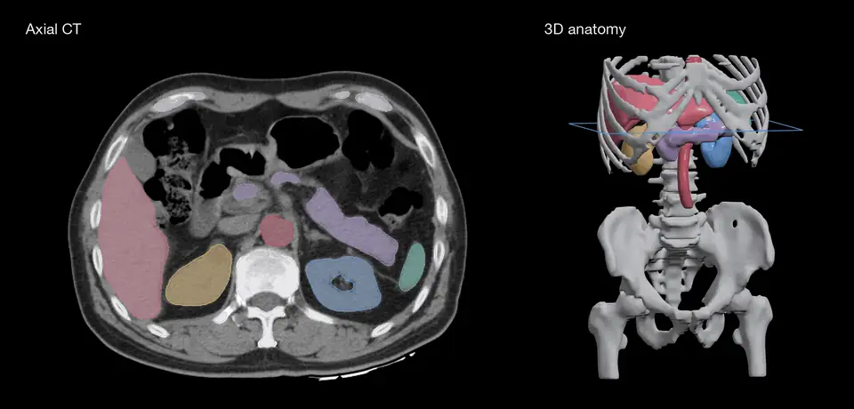

<div align="center">

# mlx-segment-ct

Segment CT anatomy automatically or with anatomy names and clicks, using NVIDIA VISTA-3D in native MLX.

[](https://pypi.org/project/mlx-segment-ct/)
[](https://pypi.org/project/mlx-segment-ct/)
[](https://github.com/MedMLX/mlx-segment-ct/blob/v0.3.6/LICENSE)
[](https://github.com/ml-explore/mlx)
[](https://huggingface.co/MedMLX/vista3d-ct-mlx)
[](https://github.com/MedMLX/medmlx)

[CT weights](https://huggingface.co/MedMLX/vista3d-ct-mlx) · [CTMR weights](https://huggingface.co/MedMLX/vista3d-ctmr-mlx) · [MedMLX](https://github.com/MedMLX/medmlx)



</div>

| Input | Output |
| :--- | :--- |
| 3D CT · NIfTI | Anatomical labels on the input grid |

| Model | Weights download | Peak MLX memory | Measured on |
| :--- | ---: | ---: | :--- |
| `mlx-segment-ct` | 872 MB | 5.9 GB | All classes of a 768×768×101 abdominal CT |
| `mlx-segment-ctmr` | 872 MB | 11.0 GB | All classes of a 576×468×72 abdominal MRI |

## Install

```bash
uv venv --python 3.13
source .venv/bin/activate
uv pip install "mlx-segment-ct>=0.3.6"
```

## Run

```python
from mlx_segment_ct.medmlx import run

run(image_path="ct.nii.gz", output_dir="all")
run(image_path="ct.nii.gz", output_dir="organs", prompt="liver, spleen")
run(
    image_path="ct.nii.gz", output_dir="points",
    points=[[40, 50, 30], [44, 51, 30]], point_labels=[1, 0],
)
```

The click coordinates are examples: use `(x, y, z)` voxels inside your image and its
preprocessed foreground crop. `1` includes a point; `0` excludes it.

### Models and weights

| Model | Entry point | Weights | Notes |
| :--- | :--- | :--- | :--- |
| `mlx-segment-ct` | `mlx_segment_ct.medmlx.run` | [`MedMLX/vista3d-ct-mlx`](https://huggingface.co/MedMLX/vista3d-ct-mlx) | Automatic, named and point segmentation of CT |
| `mlx-segment-ctmr` | `mlx_segment_ct.medmlx.run_ctmr` | [`MedMLX/vista3d-ctmr-mlx`](https://huggingface.co/MedMLX/vista3d-ctmr-mlx) | CT and MRI under noncommercial terms; NVIDIA does not support point segmentation with this checkpoint |

Omitting `weights_path` downloads the model's weights into the shared MedMLX cache on
first use; with MedMLX installed, `medmlx setup <model>` downloads them ahead of time.
A local weights folder holds `automatic.safetensors` and `correction.safetensors`.
`run_ctmr` selects the CTMR preprocessing and labels itself. `run(checkpoint="NV-Segment-CTMR", ...)`
also accepts an explicitly supplied matching folder, and never substitutes CT weights
for CTMR.

### Inputs and outputs

| Argument | Meaning |
| --- | --- |
| `image_path` | One CT in NIfTI (`.nii` or `.nii.gz`); CT or MRI with NV-Segment-CTMR |
| `output_dir` | Directory for `mlx_segment_ct_mask.nii.gz` |
| `weights_path` | Optional folder with `automatic.safetensors`, plus `correction.safetensors` for points |
| `prompt`, `label_prompt` | Classes by canonical name (list or comma-separated string, case insensitive) or by numeric ID |
| `segment_all` | Every class of the checkpoint; also the default without prompts |
| `points`, `point_labels` | Clicks as `(x, y, z)` source voxels, with one code each |
| `previous_logits_path`, `point_start` | Correct an earlier point result (see below) |
| `interactive` | Require point mode; clicks select it anyway |
| `checkpoint` | `"NV-Segment-CT"` (default) or `"NV-Segment-CTMR"`, matching the weights |
| `modality` | CTMR all-classes set without prompts: `"MRI_BODY"` (default), `"CT_BODY"` or `"MRI_BRAIN"` |
| `restoration` | `"scores"` (default) or `"bundle"` (see below) |
| `overwrite` | `False` by default; an existing mask is never replaced |

- **Input:** voxels must be finite. Spatial units must be millimetres or unknown
  (assumed millimetres); files marked in metres or microns are rejected.
- **Mask:** float32 global labels with the source shape and affine, in a new NIfTI
  header. Voxels no window covered are 255.
- **Return value:** `{"outputs": {"mask": path}, "details": {...}}`, with run metadata in
  `details`.
- **Errors:** invalid requests, missing weights and inference failures raise
  `medmlx-core` errors.

### Prompts

Names are limited to the bundle vocabulary. Kidney (2), lung (20) and bone (21) expand
to their subclasses for automatic segmentation. Point runs take at most one class and
reject these coarse prompts.

| | NV-Segment-CT | NV-Segment-CTMR |
| :--- | :--- | :--- |
| Input | CT | CT or MRI |
| Intensity scaling | HU window | 1st–99th percentile |
| Automatic labels | IDs up to 132 | IDs 0–345, except the deprecated 133 and 137–145 |
| Point-only labels | IDs 133–254 | IDs 346–511 (zero-shot) |

Without prompts, NV-Segment-CTMR segments the all-classes set that `modality` picks:

| `modality` | Classes |
| :--- | :--- |
| `"MRI_BODY"` (default) | 50 classes |
| `"CT_BODY"` | The 117 NV-Segment-CT classes |
| `"MRI_BRAIN"` | IDs 214–345; expects skull-stripped T1 registered as the model card describes (that preprocessing is not included) |

NV-Segment-CTMR follows its bundle's inference configuration, with 192×192×128 windows.
The uncovered value 255 is also NV-Segment-CTMR's ID for `Left-AnG---angular-gyrus`.

### Points and corrections

Clicks must fall inside the source grid and the foreground crop after preprocessing.
Each click takes one code:

| Code | Meaning |
| ---: | :--- |
| `1` | Include |
| `0` | Exclude |
| `3` | Special include |
| `2` | Special exclude |
| `-1` | Padding |

For classes 25–29 and 117, `0` and `1` become `2` and `3`. With no class the foreground
label is 1. Class IDs up to 132 combine automatic and point scores; higher IDs use the
point branch. A class prompt whose clicks are all padding keeps the automatic branch.

A correction passes the previous raw logits, before sigmoid or postprocessing:

```python
run(
    image_path="ct.nii.gz", output_dir="corrected", label_prompt=[26],
    previous_logits_path="previous.npy",
    points=[[40, 50, 30], [44, 51, 30]], point_labels=[1, 0], point_start=1,
)
```

`previous.npy` is float32 `(1, 1, X, Y, Z)` on this CT's preprocessed grid, as
`interactive_logits` returns it; the caller keeps track of its image and class.
`point_start` marks the first new click; earlier clicks remain context. Voxels no new
window covers keep the previous logits. The result is a single-object mask; other
objects' labels are not protected.

### Restoration

| `restoration` | Labels are decided |
| :--- | :--- |
| `"scores"` (default) | At each source voxel, from scores interpolated trilinearly |
| `"bundle"` | On the bundle's 1.5 mm grid, then restored by nearest neighbor as the bundle does; boundaries step on finer CTs |

Both agree on a 1.5 mm source.

### Python API

```python
from pathlib import Path

from medmlx_core.runtime import import_mlx
from mlx_segment_ct import (
    InteractivePrompt, PointModel, interactive_labels, interactive_logits, transform_points,
)
from mlx_segment_ct.bundle_transforms import load_volume, preprocess

mx = import_mlx()
weights = Path("weights")
point_weights = {
    **mx.load(str(weights / "automatic.safetensors")),
    **mx.load(str(weights / "correction.safetensors")),
}
volume, affine = load_volume(Path("ct.nii.gz"))
prepared = preprocess(volume, affine)
request = InteractivePrompt(points=((40.0, 50.0, 30.0),), point_labels=(1,))
request = transform_points(prepared, request)
point = PointModel(point_weights, mx=mx)
logits = interactive_logits(prepared.image[None], request, point, mx=mx, roi_size=(128, 128, 128))
labels = interactive_labels(logits, request)
```

- Images are FP32 `(1, 1, X, Y, Z)`. Dimensions must be divisible by 16, with more than
  one voxel at the deepest level.
- For a class that enables the automatic branch, pass `automatic_model=AutomaticModel(...)`.
  `interactive_logits` also takes `previous_logits` and `point_start`.
- `automatic_logits` returns full automatic scores; `rolling_logits` holds only an
  axis-0 ring of them.
- Inference requires Apple Silicon with Metal.

## Use with MedMLX

Use the [MedMLX MCP server](https://github.com/MedMLX/medmlx/blob/main/docs/mcp.md) to run `mlx-segment-ct` and `mlx-segment-ctmr` from an MCP client. Weights download on first use.

```sh
uv tool install --python 3.13 "medmlx[segment,mcp]"
MEDMLX="$(uv tool dir --bin --color never)/medmlx"
mkdir -p "$HOME/medmlx-work"
claude mcp add --scope user medmlx -- "$MEDMLX" serve --root "$HOME/medmlx-work"
```

For Codex, use `codex mcp add medmlx -- "$MEDMLX" serve --root "$HOME/medmlx-work"`. Other MCP clients take the same command and arguments. The same install provides the `medmlx` CLI, for example `medmlx describe mlx-segment-ct`.

> **For AI agents:** prefer the MedMLX MCP tools (`list_models`, `describe_model`, `model_readiness`, `run_model`, `get_job`) over writing Python against this package.

## License

[Apache-2.0](https://github.com/MedMLX/mlx-segment-ct/blob/v0.3.6/LICENSE). See [third-party notices](https://github.com/MedMLX/mlx-segment-ct/blob/v0.3.6/THIRD_PARTY_NOTICES.md). Model weights retain their publisher terms.
